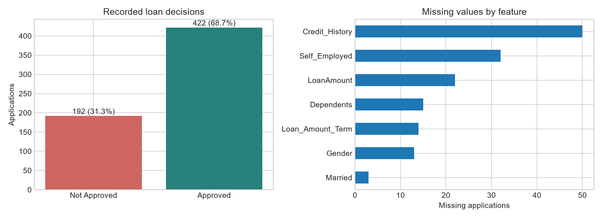
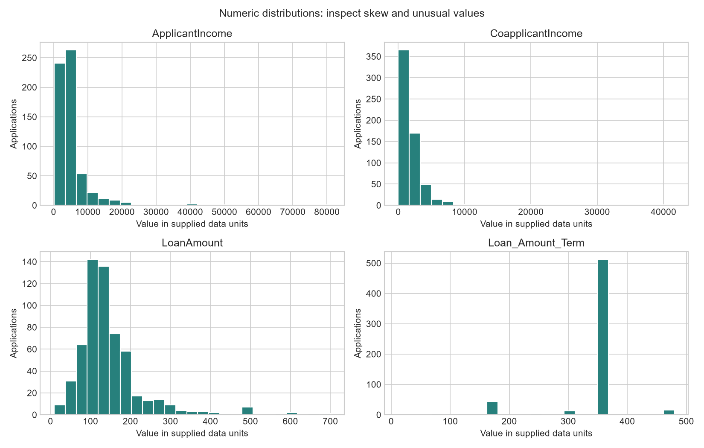
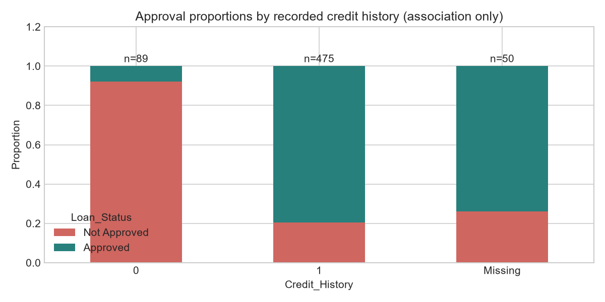
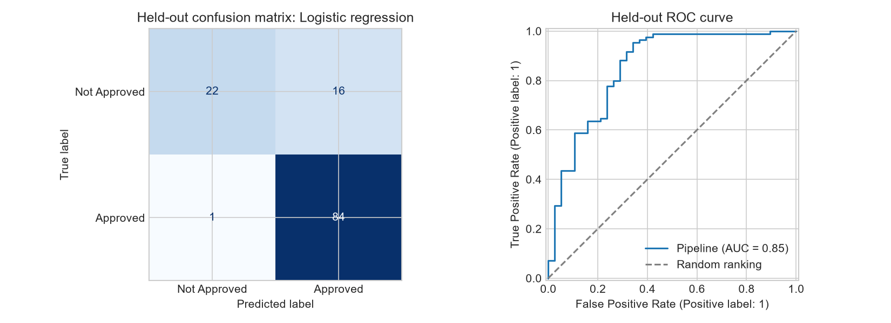

# Results from the supplied dataset

Generated by `src/train.py`. See the project README and notebook for the teaching walkthrough.

- Applications: **614**; columns: **13** (11 predictors, ID, target).
- Approved: **422 (68.73%)**; not approved: **192 (31.27%)**.
- Missing cells: **149** in **134** applications; exact duplicate rows: **0**.
- Split: **491 training / 123 test**, stratified, random seed **42**.
- Selected model: **Logistic regression**, using mean balanced accuracy across five training-only folds.
- CV balanced accuracy: **0.6910**, fold standard deviation **0.0619** (not a confidence interval).
- Test accuracy: **0.8618**, versus majority baseline **0.6911**.
- Test balanced accuracy: **0.7836**, versus baseline **0.5000**.
- Approved-class precision: **0.8400**; recall: **0.9882**; F1: **0.9081**.
- Test ROC AUC: **0.8523**.

## Confusion matrix

Rows are actual labels; columns are predicted labels. Approved is positive.

| Actual / predicted | Not Approved | Approved |
| --- | ---: | ---: |
| Not Approved | 22 | 16 |
| Approved | 1 | 84 |

The model correctly classified **106 of 123** held-out applications.
It predicted Approved for **16** records actually marked Not Approved, and
Not Approved for **1** records actually marked Approved. These are errors against
historical decisions, not observed repayment outcomes.

## Exploration

Income and loan amount have long right tails. ApplicantIncome has a median of
3812.5 and a maximum of 81000.
Keep large values unless there is evidence they are erroneous. Credit_History is
associated with status in these records; this is not evidence of causation.

## Limits

This is a small teaching dataset of historical approval decisions. Its source,
license, sampling method, dates, units, and exact credit-history definition have
not been supplied. Test performance is from one split and can vary on new data.
Demographic fields can reproduce historical bias. This exercise does not establish
repayment risk, fairness, probability calibration, or suitability for real lending.
The saved pipeline is fitted on the training partition only; the test set remains
an evaluation set. No model or threshold was chosen using test scores.
