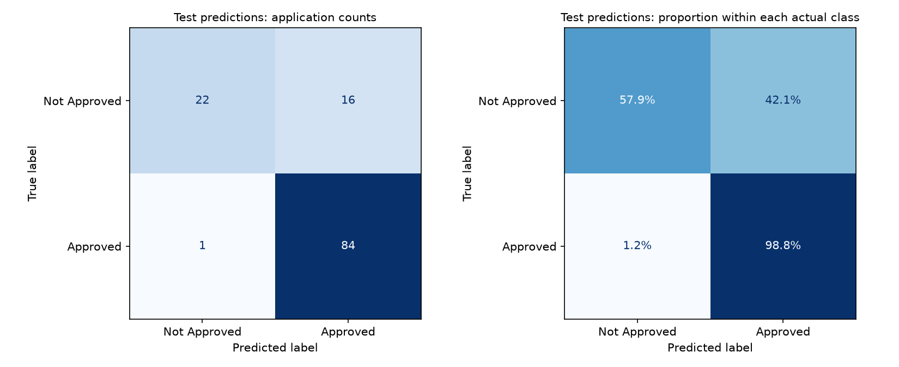
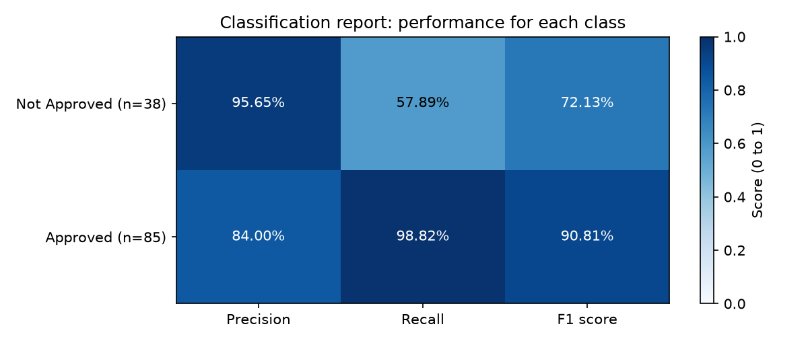

# Task 4: model evaluation results

Generated by `src/evaluate.py` using Task 3's saved **Logistic regression**
pipeline and the original **123 test applications**. No fitting, model
selection, threshold tuning, or new random split occurs here. This re-examines
Task 3's existing test results; it is not an independent new evaluation sample.

## Metrics

Approved (1) is the positive class. Values below are percentages.

| Metric | Selected model | Majority baseline |
| --- | ---: | ---: |
| accuracy | 86.18% | 69.11% |
| precision approved | 84.00% | 69.11% |
| recall approved | 98.82% | 100.00% |
| f1 approved | 90.81% | 81.73% |
| balanced accuracy | 78.36% | 50.00% |

The baseline always predicts Approved, the most common
**training** label. It provides a useful reference for the unequal class sizes.

## Confusion matrix

Rows are actual labels; columns are predicted labels.

| Actual / predicted | Not Approved (0) | Approved (1) |
| --- | ---: | ---: |
| Not Approved (0) | 22 (TN) | 16 (FP) |
| Approved (1) | 1 (FN) | 84 (TP) |

- **Accuracy:** 106/123 predictions are correct (86.18%).
- **Approved precision:** 84/100 predicted approvals match an actual Approved label (84.00%).
- **Approved recall:** 84/85 actual Approved records are found (98.82%).
- **False positives:** 16 Not Approved records are predicted Approved.
- **False negatives:** 1 Approved records are predicted Not Approved.
- **Not Approved recall:** 22/38 = 57.89%.



The normalized chart divides each row by that actual class's total. Its diagonal
shows recall for each class. It makes the difference between the two recalls
visible even though there are fewer Not Approved records.

## Classification report

```text
              precision    recall  f1-score   support

Not Approved     0.9565    0.5789    0.7213        38
    Approved     0.8400    0.9882    0.9081        85

    accuracy                         0.8618       123
   macro avg     0.8983    0.7836    0.8147       123
weighted avg     0.8760    0.8618    0.8504       123
```



**Support** is the number of actual records in each class. **Macro average** gives
each class equal weight. **Weighted average** weights each class by its support,
so the larger class influences it more. **F1** is the harmonic mean of precision
and recall. Undefined ratios are reported as zero (`zero_division=0`); this does
not provide evidence of precision for a class with no predicted examples.

## Interpretation and limits

The model beats the majority baseline on accuracy and balanced accuracy on this
test set. It finds most Approved records, but misses 16 of 38 Not Approved
records (42.11%). Therefore the high Approved recall does not mean
equally strong performance on both classes. Which error matters more depends on
the purpose of the classifier; that tradeoff has not been specified here.

These labels describe historical approval decisions, not whether loans were
repaid. The source, license, sampling method and dates are unverified; see
[the data record](../data/README.md). This is one small test split, and future
performance may differ. Overall metrics do not measure fairness across groups.
Do not tune against these results: compare changes using training-only validation
and reserve new untouched data for a future final evaluation.

## Reproducibility

The evaluation checks the raw-data fingerprint, dependency versions, unique IDs,
saved train/test assignments, and agreement with Task 3's original predictions.
Test and training IDs are disjoint. `reports/metrics.json` records the data,
model and split-manifest SHA-256 fingerprints. Prediction tables contain only
IDs, labels, scores and correctness; inspect errors in
`reports/misclassified_applications.csv`.
