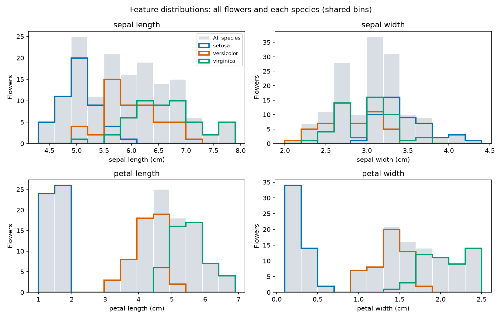

# Iris Data Exploration

Start with the [findings report and charts](reports/findings.md), which can be
read on GitHub. Open the [guided notebook](notebooks/01_iris_exploration.ipynb)
to run the code. The HTML walkthrough is a local export; generate it using the
commands below and open it in your browser.

## Status

Complete: dataset inspection, missing-value checks, descriptive statistics,
histograms, box plots, scatter plots, a pair plot, and a correlation heatmap.

## Data

Uses `sklearn.datasets.load_iris(as_frame=True)`, bundled with scikit-learn.
No CSV upload or network download is needed. The analysis table contains
**150 rows**, **four numeric measurements in centimeters**, and a **species**
column. There are 50 samples each of setosa, versicolor and virginica.
See [data provenance](data/README.md) for attribution and version information.

## Completed work

- [x] Inspect shape, feature names, types, and species labels.
- [x] Check missing values and repeated rows; document preparation choices.
- [x] Summarize features overall and by species.
- [x] Create histograms, box plots, scatter plots, a pair plot and correlations.

## Run the project

From the repository root in PowerShell:

```powershell
.\.venv\Scripts\python.exe -m pip install -r projects/05_iris_data_exploration/requirements.txt
.\.venv\Scripts\python.exe projects/05_iris_data_exploration/src/explore.py
.\.venv\Scripts\python.exe -m jupyterlab projects/05_iris_data_exploration/notebooks/01_iris_exploration.ipynb
```

Use the environment's Python kernel. In Jupyter, choose **Kernel > Restart Kernel
and Run All Cells**. The notebook finds the project from inside the repository.
The script resolves paths relative to itself and saves charts without opening
windows. The notebook explains the commands and includes practice questions.

## Main findings

- **No missing cells:** no filling or dropping was needed. The script supports
  median filling of missing numeric measurements for descriptive analysis, but
  that branch is unused here. It rejects missing species and all-missing features.
- **One repeated row beyond its first occurrence:** rows 101 and 142 have equal
  recorded measurements and species. Both remain; equal measurements do not
  establish a recording error.
- **Petal measurements show clearer species differences:** setosa has small,
  distinct petals; versicolor and virginica overlap. Sepal measurements overlap
  more among species.
- **Petal length and width correlate strongly:** pooled Pearson correlation is
  about 0.963. This is association, not causation; pooled correlations can differ
  from within-species correlations.

Box plot outliers are flagged observations, not proven errors. This small,
balanced teaching dataset does not establish population proportions or future
model performance. The task performs exploration without training a model.
For later modeling, learn any imputation values on training data only.

## Saved outputs



- `data/processed/iris_explored.csv`: all 150 observations with named species.
- `reports/data_overview.csv`: types, counts and missingness before preparation.
- `reports/descriptive_statistics.csv` and `statistics_by_species.csv`: summaries.
- `reports/species_counts.csv`: counts per species.
- `reports/repeated_measurements.csv`: both observations in the repeated group,
  with original zero-based row indices.
- `reports/feature_correlations.csv`: numeric feature correlations.
- `reports/summary.json`: quality results, versions and exported CSV fingerprint.
- `reports/findings.md`: interpretation with charts.
- `reports/figures/`: five PNG figures covering all four features.
- `reports/iris_exploration_executed.ipynb` and `iris_exploration_walkthrough.html`:
  executed notebook and browser-readable lesson, generated during validation.

PNG charts and the Markdown findings report are included in version control so
the pictures can display on GitHub. Generated data, HTML and executed notebooks
remain ignored. The source notebook has cleared outputs; run it locally to see
its output, or read the findings report for the saved charts. To regenerate the
local HTML lesson:

```powershell
.\.venv\Scripts\python.exe -m jupyter nbconvert --to notebook --execute --ExecutePreprocessor.kernel_name=python3 --output iris_exploration_executed --output-dir projects/05_iris_data_exploration/reports projects/05_iris_data_exploration/notebooks/01_iris_exploration.ipynb
.\.venv\Scripts\python.exe -m jupyter nbconvert --to html --output iris_exploration_walkthrough --output-dir projects/05_iris_data_exploration/reports projects/05_iris_data_exploration/reports/iris_exploration_executed.ipynb
```

Use the environment's Python kernel. The HTML embeds the executed notebook charts.

## Layout

| Folder | Purpose |
| --- | --- |
| `data/raw/` | Original input files; keep unchanged. |
| `data/interim/` | Intermediate cleaning outputs. |
| `data/processed/` | Analysis-ready or model-ready data. |
| `notebooks/` | Numbered Jupyter notebooks, such as `01_exploration.ipynb`. |
| `src/` | Reusable analysis, preprocessing, and training code. |
| `models/` | Generated model artifacts. |
| `reports/` | Written findings, metrics, and tables. |
| `reports/figures/` | Exported plots. |

Use the environment setup in the [root README](../../README.md). Record project-specific dependencies in a local `requirements.txt` when needed.
