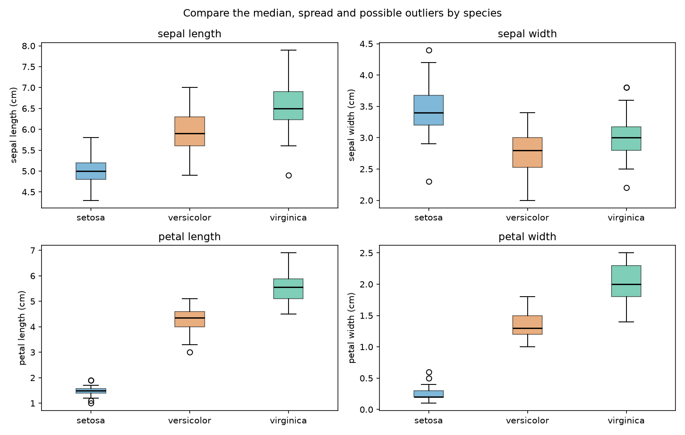
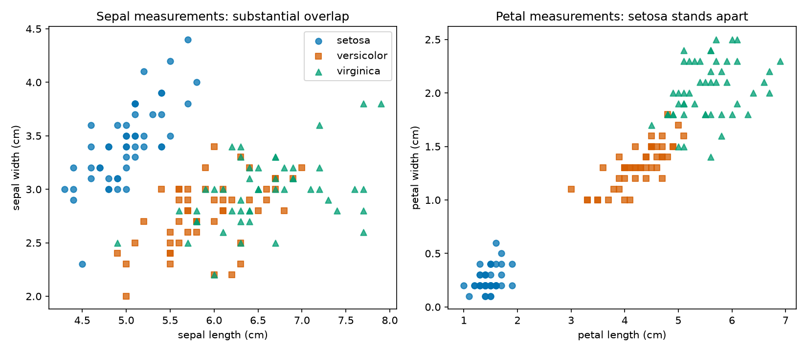
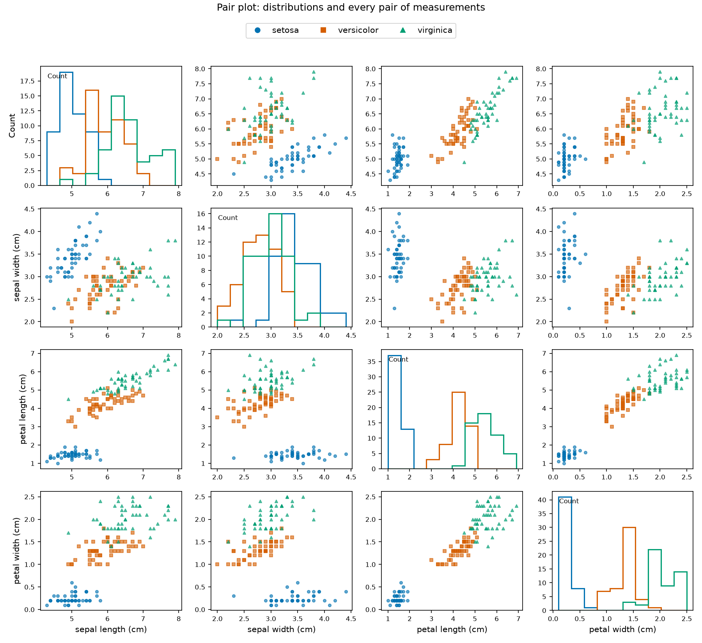
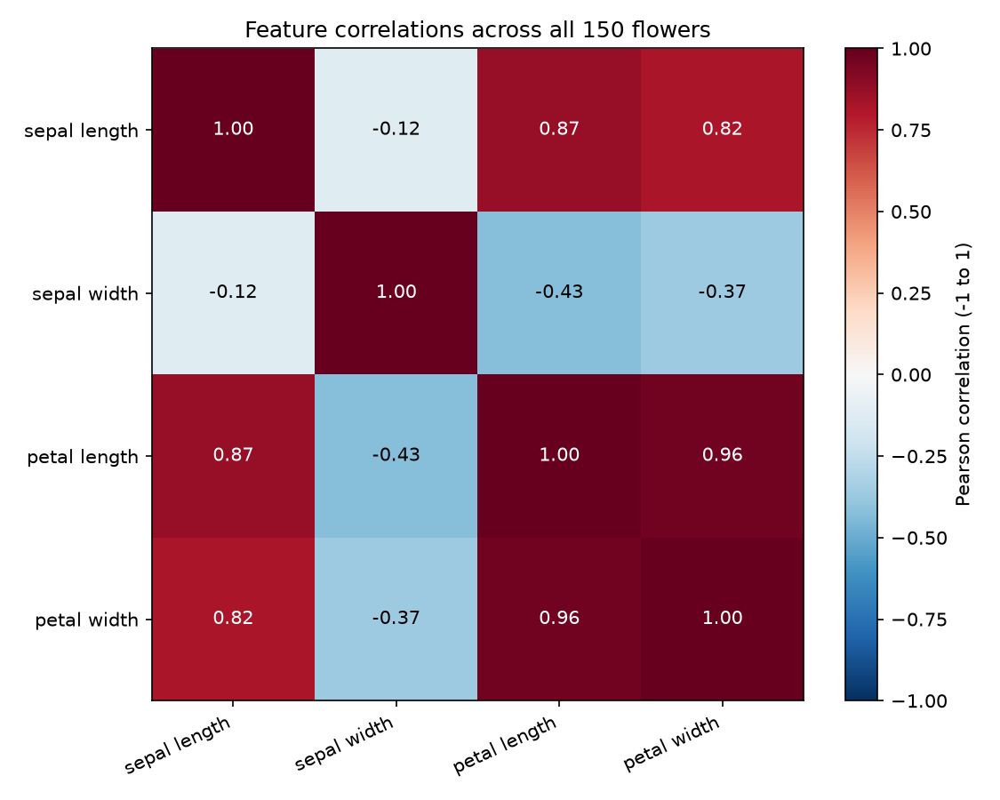

# Task 5: Iris exploration findings

Generated by `src/explore.py` from scikit-learn's bundled Iris dataset.

## Structure and quality

- **150 rows**, **4 numeric features**, and a categorical `species` label.
- Species counts: setosa = 50, versicolor = 50, virginica = 50.
- All four measurements are in **centimeters**.
- Missing cells: **0**; imputed feature cells: **0**.
- Repeated rows beyond the first occurrence: **1**
  (2 rows in the repeated group). Retained; matching measurements
  at the recorded precision do not prove a duplicated observation.

The supplied data needs no missing-value imputation. No observations were removed
or scaled. The optional missing-feature branch uses medians for descriptive
exploration only and rejects missing species or entirely missing features.

## Feature distributions

| Feature | Minimum | Maximum | Mean | Median |
| --- | ---: | ---: | ---: | ---: |
| sepal length (cm) | 4.3 | 7.9 | 5.843 | 5.80 |
| sepal width (cm) | 2.0 | 4.4 | 3.057 | 3.00 |
| petal length (cm) | 1.0 | 6.9 | 3.758 | 4.35 |
| petal width (cm) | 0.1 | 2.5 | 1.199 | 1.30 |

Each gray histogram shows all flowers; colored outlines show species using the
same bin edges. Sepal length spans 4.3–7.9 cm with overlapping species; sepal width
spans 2.0–4.4 cm and also overlaps strongly. Petal length and width show a distinct
small-petal setosa group. The combined distribution mixes three species, so
multiple peaks need not indicate an error. Bin choices affect histogram shape.

Boxes show the middle 50% of measurements; the line is the median. Whiskers extend
to the most extreme observations within 1.5 interquartile ranges of the box.
Points beyond them are possible outliers, not automatically errors. Setosa has
the smallest petals; virginica has the largest average petal measurements;
versicolor is intermediate. Sepal distributions overlap more.

## Relationships

Each scatter point represents a flower; identical measurements may overlap.
Petal measurements separate setosa clearly in this sample, while versicolor and
virginica overlap. A pair plot shows every pair of measurements, with histograms
on the diagonal. Its diagonal y-axis is a count, not a measurement.

Petal length and petal width have a strong overall positive Pearson correlation
(**0.963**). This is association, not causation. Pooling species can
strengthen or hide relationships within species. The species labels are
categories and are excluded from numerical correlations.

## Conclusion and limits

This exploration meets the task: load the data, inspect its structure, check
missingness and repeated rows, summarize each feature and visualize distributions.
No missing-value treatment was necessary. Petal measurements show clearer
species differences than sepal measurements in this dataset. This small,
balanced teaching sample does not establish population proportions or guarantee
classification performance. No predictive model was trained or evaluated.

## Sources and reproduction

Use the [scikit-learn loader documentation](https://scikit-learn.org/stable/modules/generated/sklearn.datasets.load_iris.html)
and [data provenance record](../data/README.md). The loader documents corrections
relative to the original UCI copy. The historical dataset is credited to
R. A. Fisher (1936); the [UCI record](https://www.archive.ics.uci.edu/dataset/53/iris)
lists CC BY 4.0. The local analysis uses scikit-learn's packaged version.
`reports/summary.json` records dependency versions and the exported CSV fingerprint.
The script resolves paths relative to itself and needs no network connection.
